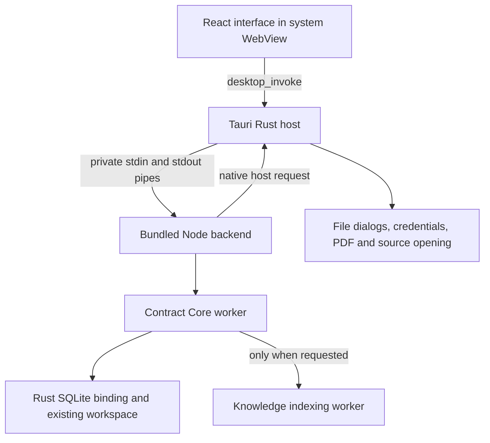

# Tauri desktop migration

The default desktop shell is Tauri 2. The existing React interface and contract workflows run in the operating system WebView. A Rust host owns the application window, file dialogs, external-source opening, credential protection and PDF export. Electron remains available as a development reference for regression and memory comparisons.

This is an incremental migration: the business engine still runs in one bundled Node.js sidecar, using the native Rust SQLite binding. It is not a complete Rust rewrite. Node.js is bundled with the installer; end users do not need to install Node, npm or Rust.

## Runtime architecture



The sidecar does not open a local HTTP server. The renderer has no direct filesystem, SQL, credential-store or arbitrary shell API. Existing command validation remains in `src/desktop/runtime.ts`; the Rust host additionally checks the originating window and local application URL. Task updates use the `desktop-task` event.

The anonymous pipe protocol uses UTF-8 JSON lines, a 64 MiB frame limit, bounded write buffering and at most 32 concurrent commands. Host replies and cancellation continue to be processed while another command awaits a dialog or network request. Malformed frames close the session without echoing their content. The backend's stdout contains protocol frames only.

The Core worker preserves the established review, document, knowledge and reporting implementations. The indexing worker now starts on its first knowledge or environment request. Closing an unused index client does not start a worker. Once used, that worker remains available until service shutdown; this is not an automatic eviction policy.

Tauri uses the platform WebView rather than bundling an Electron Chromium distribution. The operating system can still create WebView content, networking and graphics processes. See [Tauri architecture](https://v2.tauri.app/concept/architecture/) for the underlying platform model.

## Feature continuity

The adapter retains the existing bridge methods and workspace actions, including:

- DOCX and PDF import, original-file retention, document versions and paged source/history access.
- Configurable model APIs, Codex CLI integration, model checks, review progress and cancellation.
- Enterprise review standards, risk dispositions and deterministic amount/date verification.
- Local knowledge configuration, incremental indexing, remote connections and quoted retrieval evidence.
- Official-source discovery and reading, source opening and citation-aware review.
- Change preview, individual decisions, clean/tracked DOCX export and existing revision retention.
- Contract generation, confirmed authoring exports, multilingual alignment, translation and reports.
- Backup inspection, backup/restore, recoverable index clearing and workspace maintenance.

This forwarding inventory is not a claim that every feature has undergone Windows and macOS desktop acceptance. The contract engine's regression suite, private-pipe integration, native-platform tests and actual desktop smoke each establish different parts of parity. Legal and translation correctness still require the planned lawyer acceptance.

## Existing data and paths

The same schema-7 `workspace.sqlite`, originals under `documents/`, knowledge index and existing assets remain in use. The SQLite engine, migration backups, writer lease, transaction rules and quoted-text anchors are unchanged by the shell replacement. Close older versions before opening the same workspace.

Production paths preserve the legacy package name:

| Platform | Default workspace |
| --- | --- |
| macOS | `~/Library/Application Support/law-agent-desktop` |
| Windows | `%APPDATA%\law-agent-desktop` |
| Development | Project `.local/data` |

`LAW_AGENT_DATA_DIR` explicitly selects another workspace. Always use a temporary, isolated directory for validation. WebView session data is separate under `webview-tauri`; it is not a new contract database.

The macOS production path was checked by cloning a closed Electron distribution, replacing only the clone's entry archive with a minimal probe, and retaining its package metadata and bundle identity. The probe read `app.getPath('userData')` before `app.setName`, immediately assigned isolated user/session directories, then exited before loading any original application logic. It did not open the reported workspace or keychain. The original code computed the data path before setting its Chinese display name, so using the Chinese name as a new root would hide existing data. Reproduce with `node scripts/probe-legacy-desktop-path.mjs /path/to/closed/Electron.app`; this probe currently supports macOS only. The Windows path must also be accepted on Windows.

See [native business storage validation](native-business-storage-validation.md) for the prior engine migration and recovery guarantees. This shell migration does not reinterpret old contract offsets, rebuild customer indexes automatically or rewrite originals.

## Credential transition

Electron's `model-key.bin` ciphertext is retained byte for byte. Tauri stores new credentials in `model-key.tauri.bin` within each existing model, knowledge, web or extension credential directory. The two formats are separate; Tauri does not pretend it can decrypt the old Electron envelope.

A workspace with legacy ciphertext and no corresponding Tauri credential file reports `credentialMigration.legacyCredentialFiles` in application state. The interface and environment check explain that the user must re-enter the relevant keys. Model endpoints, model options, connection configuration and contract data remain saved. Re-entering or clearing a Tauri key does not delete its legacy counterpart.

On macOS, a separate OS Keychain key protects the Tauri envelope with AES-GCM. On Windows, the implementation uses current-user DPAPI. Secrets are not passed in command-line arguments, written as plaintext fallback files or returned as application state. Credential actions are lazy; ordinary local document actions do not unlock the keychain. If system protection is unavailable, keys remain in the current session and existing ciphertext is preserved. Configuration failures restore the prior credential checkpoint.

Legacy key re-entry is a migration requirement, not automatic credential transfer. Backup/restore continues its existing policy of excluding OS-bound credential files; do not assume a workspace backup transfers system credentials to another computer.

## Native PDF export and shutdown

Report export uses an on-demand native renderer: WKWebView on macOS and WebView2 on Windows. It creates a PDF directly rather than requiring a system print dialog. Export rendering disables scripts, applies an offline resource policy and releases the temporary renderer afterward. User-selected output files retain exclusive-create behavior. Platform rendering differences, fonts and multilingual pagination require visual acceptance on the target OS.

Normal shutdown cancels review/index network work, drains accepted operations, closes SQLite and releases the kernel writer lease. A backup, restore or other critical maintenance operation finishes publication/rollback before shutdown completes; the backend sends `shutdownDeferred` while maintenance is active. There is no fixed 30-second forced exit during maintenance. An OS kill or power failure is still an interruption and relies on the existing recovery rules.

## Build and run

Use the repository's required Node version for development, plus a supported Rust toolchain and Tauri's platform build prerequisites. Build on the target operating system and architecture. The pinned Node.js 24.22.1 runtime requires macOS 13.5 or newer, so that is the packaged application's macOS minimum; see [Node.js build support](https://github.com/nodejs/node/blob/v24.22.1/BUILDING.md). The scripts keep Cargo caches and artifacts under `.local` and resolve the installed Rust toolchain when it is absent from the interactive shell's PATH.

```sh
npm ci
npm run dev
```

The default development command builds the frontend/backend assets, prepares a checksum-verified portable Node runtime and starts Tauri. The first build may download Rust crates, the pinned Node runtime and platform build tools. Build artifacts and caches are not public source or customer data.

```sh
npm run build
npm run pack:mac
# Run on Windows for a Windows installer:
npm run pack:win
```

The staged runtime is `.local/tauri-runtime`, containing the compiled backend, production dependency closure, native SQLite binding and Node executable. Its `runtime-manifest.json` records file hashes, target platform and architecture. Development dependencies, Electron and customer workspaces are excluded. A stale or mismatched native binding must be rebuilt for the target.

The Windows installer uses the WebView2 download bootstrapper if the runtime is missing. That first installation may require network access; an offline/fixed WebView distribution needs an explicit installer policy. See [Tauri Windows installer options](https://v2.tauri.app/distribute/windows-installer/). Installer generation is separate from signing, notarization and real-machine acceptance.

The retained Electron reference is explicit:

```sh
npm run dev:electron
npm run build:electron
npm run smoke:desktop:electron
```

Useful validation commands:

```sh
npm run typecheck
npm test
npm run native:test
npm run native:test:binding
npm run native:test:desktop
npm run smoke:desktop-backend
.local/tauri-runtime/bin/node scripts/verify-tauri-resources.mjs
npm run smoke:desktop
```

On Windows PowerShell, use `& ".local/tauri-runtime/bin/node.exe" scripts/verify-tauri-resources.mjs` for the resource check. Running the verifier with the bundled Node executable establishes its runtime compatibility; running it with a different development Node version does not.

`smoke:desktop-backend` expects a current `npm run build` first. It uses isolated synthetic workspaces and a mock encryption provider, covering fresh migrations, closed legacy handoff, original/approved-history retention, tracked export, local review, key namespace/restart, rejected unauthorized paths, backup/inspection/restore and clean sidecar exit. It does not exercise the real system keychain or prove native GUI/PDF behavior. Actual Tauri smoke builds use the dedicated `desktop-smoke` feature with synthetic dialog queues; production builds must omit that feature.

See [Tauri desktop validation](tauri-desktop-validation.md) for the measured synthetic workflow and both-shell process-memory comparison.

## Memory evidence and remaining acceptance

No percentage saving follows automatically from replacing a shell. Include the Tauri host, Node sidecar, all system WebView processes and any transient PDF/index processes when measuring the application. A report of the Rust host alone omits most of the work. Node worker threads share their process; do not count a worker as a separate OS process.

Use identical closed synthetic workspace copies, the same contracts, model responses, indexing policy, build mode and viewport for both shells. Record initial idle, active model review, retrieval/index activity, export, settled idle and restart. Include process identities, sampling interval, per-process values, full sample totals and exact build/runtime manifests. A local-model comparison must also separate the model's own memory from the application's overhead.

A process-tree RSS sum double-counts shared pages. macOS physical footprint, Windows working set and Windows private bytes are different measurements; label each rather than comparing them directly. System WebView services may be reparented or shared, so descendant-only process traversal can miss them. Sampling can miss brief peaks. Debug builds, warm OS caches and reused WebView processes can distort results.

The earlier native-storage/Electron measurements in the storage validation document are not Tauri measurements. The migration must be evaluated on ordinary Windows office hardware with the customer's local model, representative PDF/DOCX files and realistic knowledge activity. The 1 TB knowledge target remains a separate workload acceptance requirement. This document does not invent unmeasured savings or imply that retaining a Node sidecar removes its memory cost.

## Shutdown hardening

Connection tests and tracked model tools are cancelled before the first shutdown await. Returning asynchronous model-runtime/review-completion commands is awaited inside their tracking scopes, so the job remains cancellable until its actual cleanup and ledger writes finish. The knowledge client begins cancellation before service shutdown waits for its job, preventing a close/job dependency cycle. Its noncooperative-worker grace is 10 seconds.

Only the actual maintenance publication/rollback phase suppresses the ordinary 30-second backend grace. Once that protected phase ends, the private protocol emits `shutdownProgress: draining`; the native host adds a 35-second draining watchdog. The startup queue rejects new work after shutdown. Native PDF export has a separate cancellation gate, exact owned-resource cleanup and a bounded native print barrier.

The host handles startup errors without a deliberate panic. Rapid reopening, including a macOS Dock reopen, is queued while cleanup runs. Replacement spawning occurs on the final Exit event, after the single-instance plugin releases its socket/mutex; releasing twice could otherwise remove the replacement instance's socket. The diagnostic build uses a separate `.diagnostics` identity and temporary synthetic workspaces. Its report command and test delays are omitted from production.

The knowledge tokenizer already includes its ICU version. If the bundled Node runtime differs from the previous engine, an incompatible existing index is reported as needing synchronization instead of being silently reused. Original files and historical review snapshots remain retained.
